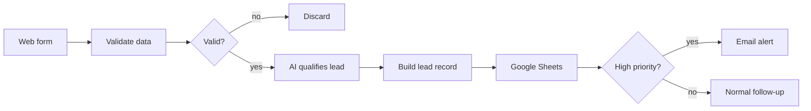

# AI Lead Qualifier – n8n + Gemini + Google Sheets + Gmail

An end-to-end automation that captures new leads from a web form, qualifies them with AI, logs them in Google Sheets and alerts the team about high-priority leads by email. No manual copy-paste, no lost leads.

▶️ **[Watch the 50-second demo](https://drive.google.com/file/d/1Rp-oSschvamBtgvrJnry9fyRAJbjJPcp/view)**

## How it works

1. **Form trigger** – a hosted n8n form collects name, email, company, message and budget.
2. **Validate data** (JavaScript) – trims and normalizes fields, validates the email, parses the budget (`US$1.000` → `1000`) and builds the AI request.
3. **Valid?** – invalid submissions are discarded before spending any AI calls.
4. **AI – qualify lead** (HTTP Request → Google Gemini) – returns structured JSON:
   `servicio` (service type), `prioridad` (High / Medium / Low), `resumen` (summary) and `accion_recomendada` (next action).
5. **Build lead record** (JavaScript) – merges form data with the AI result. If the AI call fails, the lead is still saved with priority `Revisar` (review) so nothing is lost.
6. **Google Sheets** – appends one row per lead.
7. **High priority?** – only high-priority leads send an email alert through Gmail.

## Example

Input (form):

> Juan Pérez, Clínica Dental Sur, budget US$500 – "I need to automate my clinic's inquiries on WhatsApp and web. We get many repeated questions and want to start this month."

Output (AI, real run):

| Field | Value |
|---|---|
| Service | Chatbot / IA |
| Priority | Alta (High) |
| Summary | Juan Pérez of Clínica Dental Sur wants to automate repeated inquiries on WhatsApp and web this month with a US$500 budget. |
| Next action | Contact today to schedule a discovery call. |

## Reliability

- The AI call has a 60-second timeout and retries once if it fails.
- The workflow continues on AI errors and flags the lead for manual review instead of failing.
- Invalid form data never reaches the AI step.

## Setup

1. Import `ai-lead-qualifier.workflow.json` in n8n (**Workflows → Import from file**).
2. Create a Google Sheet whose first row has these headers:
   `fecha, nombre, email, empresa, mensaje, presupuesto, presupuesto_usd, servicio, prioridad, resumen, accion_recomendada`
3. Credentials:
   - **AI – qualify lead**: Header Auth, name `x-goog-api-key`, value = your Gemini API key from Google AI Studio.
   - **Google Sheets** and **Gmail**: sign in with Google.
4. Paste your sheet URL in the Google Sheets node and your email in the Gmail node.
5. Click **Execute workflow**, open the test form and submit a lead.

To use Claude or OpenAI instead of Gemini, change the URL, auth header and request body in the HTTP node, and the response path in "Armar ficha del lead".

## Stack

n8n · Google Gemini API · Google Sheets · Gmail · JavaScript
